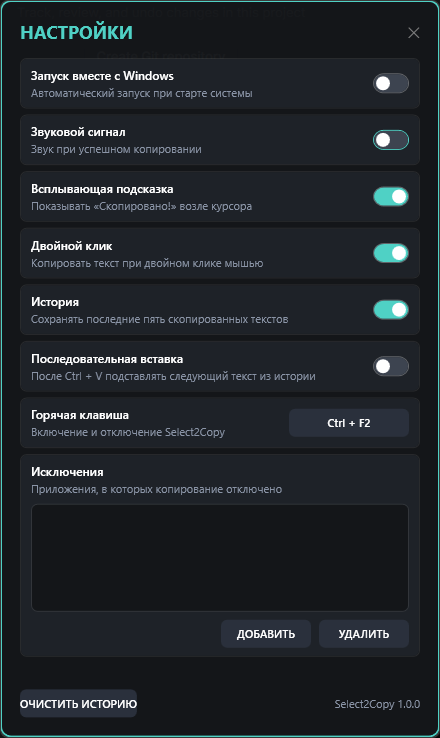

# Select2Copy

**Select2Copy** — портативное приложение для Windows, которое автоматически копирует выделенный текст. Независимая clean-room реализация в стиле AutoCopy: без лицензионных ключей, подписок и сетевых проверок.



## Три версии

Готовые файлы — в [последнем релизе](https://github.com/AEM-RU/Select2Copy/releases/latest).

| Файл | Размер | Что внутри | Когда выбирать |
|---|---:|---|---|
| `Select2Copy-net48.exe` | ~110 КБ | Только приложение; использует .NET Framework 4.8, уже встроенный в Windows 10/11 | Рекомендуется для большинства: максимальный охват и минимальный размер. |
| `Select2Copy.exe` | ~72 МБ | Приложение + .NET 10 + WPF | Если не хотите зависеть от .NET Framework. Работает сразу, ничего доустанавливать не нужно. |
| `Select2Copy-lite.exe` | ~275 КБ | Только приложение; [.NET 10 Desktop Runtime](https://dotnet.microsoft.com/download/dotnet/10.0) нужен отдельно | Если .NET 10 Desktop Runtime уже установлен или готовы его поставить. |

Все три версии — один и тот же код и одинаковый набор функций. Разница только в упаковке и используемом runtime. Если сомневаетесь — берите `Select2Copy-net48.exe`: на Windows 10/11 .NET Framework 4.8 уже есть.

Дополнительно в релизе:

- `Select2Copy.cer` — публичный сертификат, которым подписаны все exe.
- `SHA256SUMS.txt` — контрольные суммы файлов.

## Возможности

- Копирование текста при выделении мышью.
- Копирование по `Shift+клик` и по двойному клику (можно отключить).
- Глобальная горячая клавиша `Ctrl+F2` для включения и отключения; комбинацию можно изменить.
- Звуковой сигнал и всплывающая подсказка у курсора.
- История последних пяти текстов с шифрованием DPAPI.
- Окно истории: клик по элементу копирует его.
- Последовательная вставка: `Ctrl+V` подставляет следующий текст из истории.
- Исключения приложений: в указанных программах копирование не срабатывает.
- Автозапуск вместе с Windows.
- Работа в трее, без главного окна.
- Портативные настройки рядом с exe.

## Быстрый старт

1. Скачайте один из exe (обычно `Select2Copy-net48.exe`) из релиза.
2. Запустите файл. Появится значок в трее.
3. Выделите текст мышью в любом приложении — он будет скопирован.
4. Настройки: правый клик по значку в трее → «Настройки» (или средний клик).
5. История: двойной клик по значку в трее.

По умолчанию `Ctrl+F2` включает и отключает приложение.

## Настройки

- Запуск вместе с Windows.
- Звуковой сигнал.
- Всплывающая подсказка.
- Копирование по двойному клику.
- История.
- Последовательная вставка.
- Горячая клавиша.
- Исключения приложений.

Файлы создаются рядом с exe:

- `Select2Copy.json` — настройки;
- `Select2Copy.history.json` — зашифрованная история;
- `Select2Copy.log` — только ошибки, без текста буфера обмена.

Если папка с exe недоступна для записи, используется `%APPDATA%\Select2Copy`.

Дополнительные аргументы:

```powershell
Select2Copy.exe --settings
Select2Copy.exe --history
```

## Подпись

Релизные exe подписаны сертификатом `CN=Select2Copy` (самоподписанный). Публичная часть — `Select2Copy.cer`.

На другой машине подпись будет считаться доверенной только после установки сертификата в «Доверенные корневые центры сертификации» и «Доверенные издатели» текущего пользователя. Для публичного распространения лучше использовать сертификат код-подписи от CA.

Проверка (для любого из exe):

```powershell
Get-AuthenticodeSignature .\Select2Copy-net48.exe
Get-FileHash .\Select2Copy-net48.exe -Algorithm SHA256
```

## Сборка из исходников

Требуется .NET 10 SDK.

```powershell
dotnet build Select2Copy.sln -c Release

# net48, около 110 КБ; использует .NET Framework 4.8 из Windows 10/11
dotnet publish src/Select2Copy/Select2Copy.csproj -c Release -f net48 -o dist-net48

# portable, около 72 МБ
dotnet publish src/Select2Copy/Select2Copy.csproj -c Release -f net10.0-windows -r win-x64 --self-contained true -p:PublishSingleFile=true -p:IncludeNativeLibrariesForSelfExtract=true -p:EnableCompressionInSingleFile=true -o dist

# lite, около 275 КБ; нужен установленный .NET 10 Desktop Runtime
dotnet publish src/Select2Copy/Select2Copy.csproj -c Release -f net10.0-windows -r win-x64 --self-contained false -p:PublishSingleFile=true -o dist-lite
```

## Ограничения

- Только Windows 10/11 x64.
- `Select2Copy-net48.exe` требует .NET Framework 4.8 (входит в Windows 10/11). `Select2Copy-lite.exe` требует .NET 10 Desktop Runtime.
- Для копирования из окон, запущенных от администратора, Select2Copy тоже нужно запускать от администратора.
- Глобальные хуки мыши и клавиатуры могут вызывать ложные срабатывания антивирусов. Exe не упакован и не обфусцирован; при распространении рекомендуется подпись от CA.
- Последовательная вставка использует задержку около 150 мс; в очень медленных приложениях возможны особенности.
- Автообновление отсутствует.
- Не запускайте одновременно AutoCopy и Select2Copy: возможен конфликт `Ctrl+F2` и двойное копирование.

## Приватность

- Нет телеметрии и сетевых запросов.
- История шифруется DPAPI для текущего пользователя.
- Текст буфера обмена не пишется в лог.
- Исключённые приложения не обрабатываются.

## Статус

Версия 1.0.0. Проект не связан с AutoCopy; это самостоятельная реализация. Исходный код предоставляется как есть, без гарантий.
